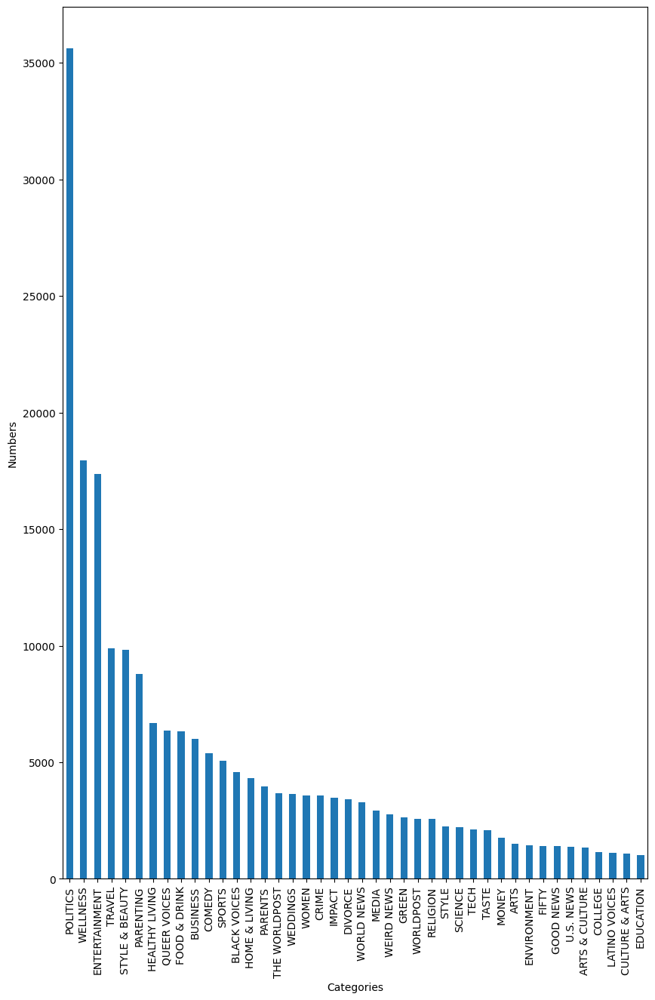
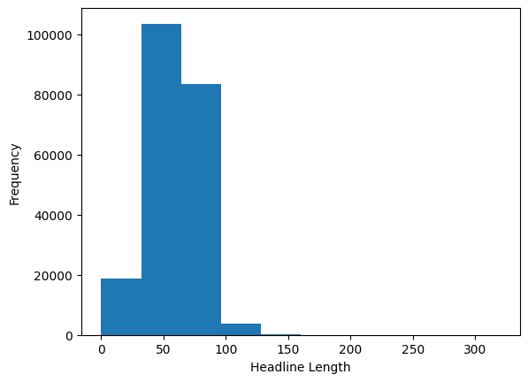
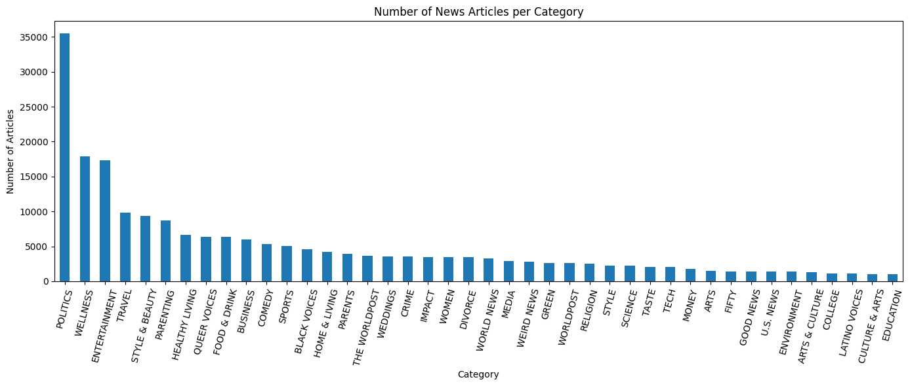
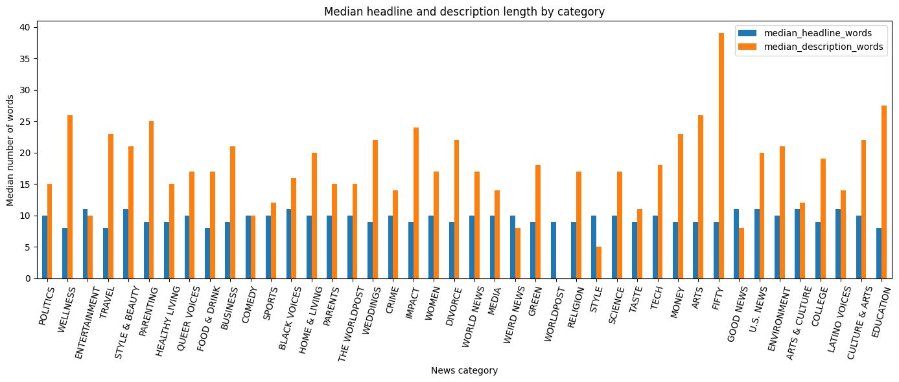
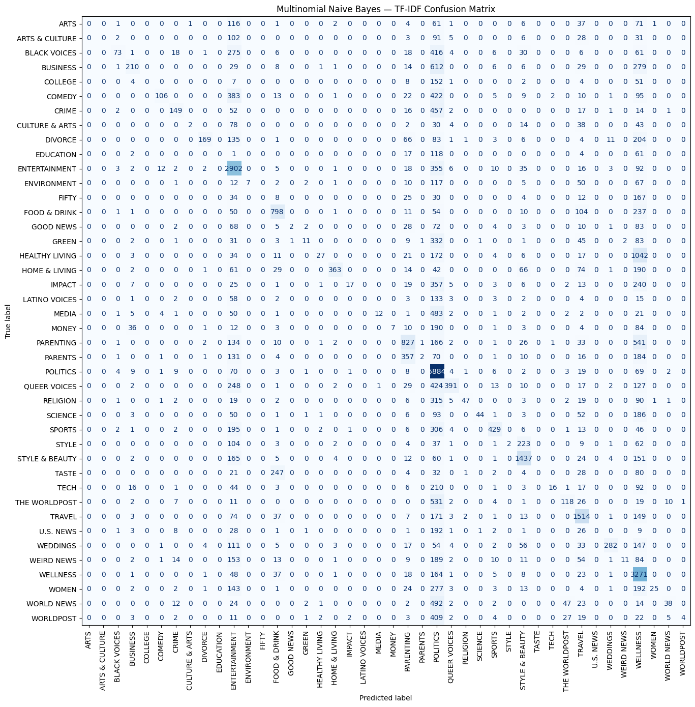
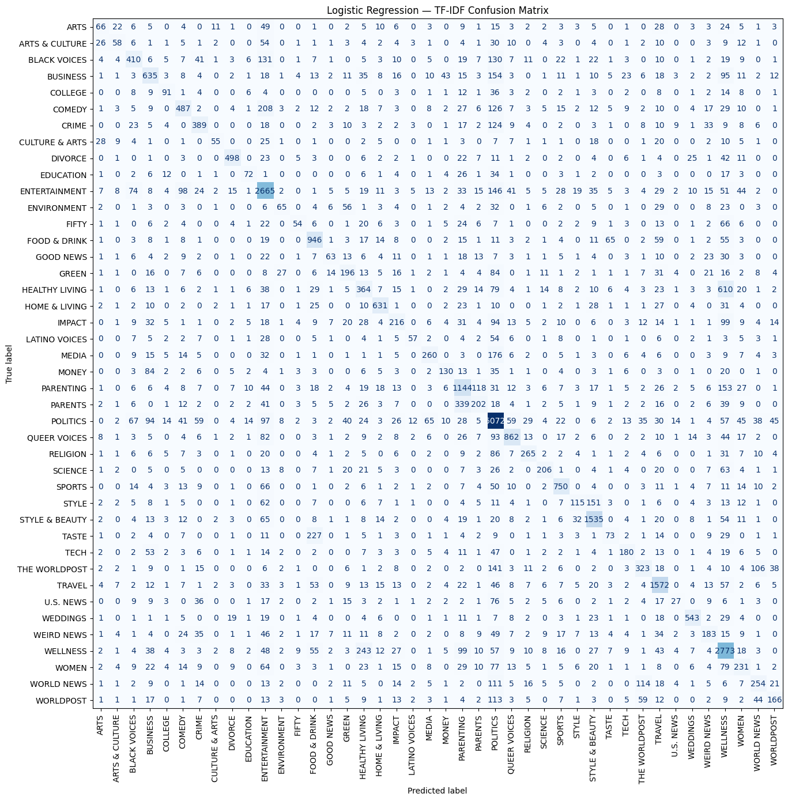
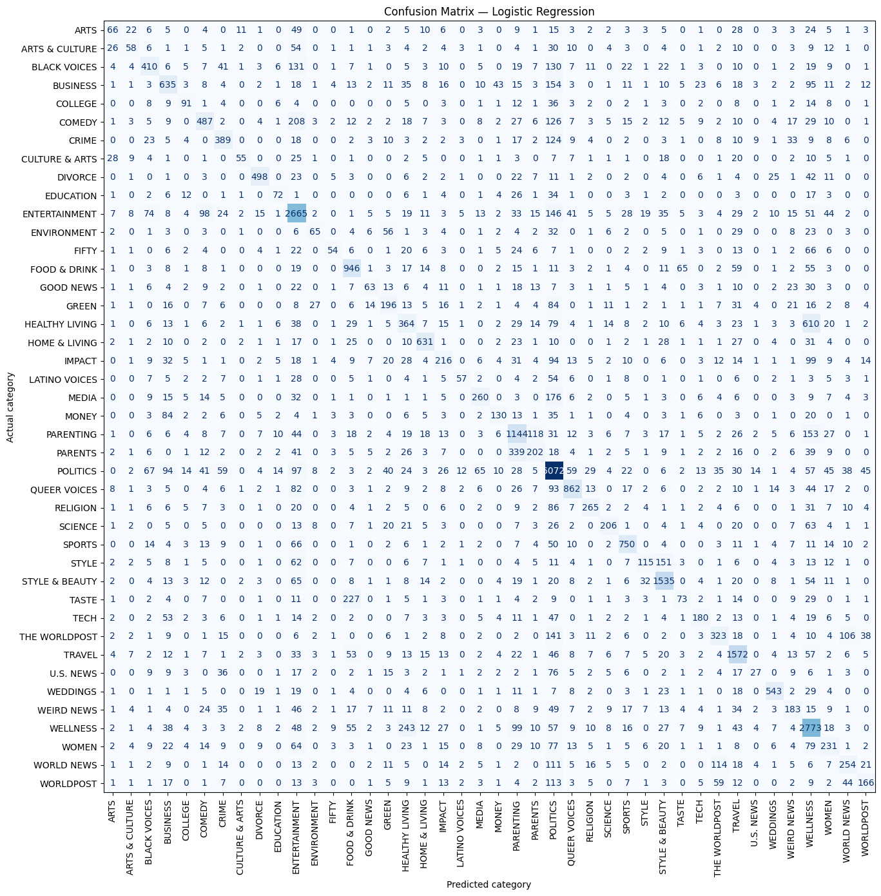

# News Category Classification Using Machine Learning

## 1. Project Overview

This project explores the use of Natural Language Processing (NLP) and machine learning to classify news articles into **42 different news categories** using the News Category Dataset (HuffPost).

The project follows an end-to-end workflow: dataset inspection, duplicate and missing-value analysis, headline and description cleaning, exploratory data analysis (EDA), TF-IDF feature extraction, model training, evaluation, and misclassification analysis.

The classification task is **multi-class classification**: the model predicts a news category (for example, POLITICS, WELLNESS, ENTERTAINMENT, or TRAVEL), rather than classifying an article as fake or real.

## 2. Project Objectives

- Inspect and understand the structure of the news dataset.
- Explore category distribution and identify class imbalance.
- Examine duplicate rows, repeated headlines, and headlines associated with multiple categories.
- Investigate headline and description lengths, outliers, missing values, and empty text.
- Clean headline and description text, including lowercasing and URL removal.
- Convert text into numerical features using TF-IDF.
- Train and compare Multinomial Naive Bayes, Logistic Regression, and Linear SVM.
- Evaluate model performance using accuracy, macro precision, macro recall, macro F1, and weighted F1.
- Inspect confusion matrices and misclassified examples.
- Compare headline-only input with combined headline-and-description input.

## 3. Dataset Description

**Dataset file:** `News_Category_Dataset_v3.json`

The dataset was loaded as newline-delimited JSON using Pandas (`pd.read_json(..., lines=True)`).

The original dataset contained **209,527 rows** and six columns:

| Column | Description |
|---|---|
| `link` | Link to the news article |
| `headline` | News headline |
| `category` | News category label |
| `short_description` | Short description of the article |
| `authors` | Article author information |
| `date` | Publication date |

The task uses the `category` column as the target label and the cleaned headline and short description as text input.

## 4. Data Cleaning and Initial Inspection

### 4.1 Duplicate Analysis

The initial inspection found **13 exact duplicate rows**. These were removed.

Repeated headlines were then examined separately:

- Repeated headline rows: 1,513
- Unique headline values: 207,995
- Headlines associated with more than one category: 102

Duplicate headline-category pairs were removed while retaining headlines that appeared under different categories. After this cleaning step, the dataset contained **208,102 rows**.

This distinction matters: the same headline can occur in more than one category, so repeated headlines were not automatically treated as identical records.

### 4.2 Missing and Empty Values

The final EDA snapshot reported:

| Check | Result |
|---|---:|
| Rows after cleaning | 208,102 |
| Number of categories | 42 |
| Duplicate full rows | 0 |
| Missing headlines | 0 |
| Empty/whitespace headlines | 0 |
| Missing descriptions (`NaN`) | 0 |
| Empty/whitespace descriptions | 19,603 |

Although no descriptions were missing as `NaN`, 19,603 descriptions were empty or contained only whitespace (approximately 9.42% of the dataset).

## 5. Exploratory Data Analysis (EDA)

### 5.1 Raw Category Distribution

The first bar chart shows the category distribution before the cleaning steps. It provides an initial view of the frequency differences between news categories.



### 5.2 Category Distribution After Cleaning

After removing exact duplicate rows and duplicate headline-category pairs, the category distribution was plotted again.

The cleaned dataset contains 42 categories. **POLITICS** is the most frequent category, with 35,478 records, while **EDUCATION** is the least frequent, with 1,014 records.



The largest category accounts for approximately 17.05% of the cleaned dataset. The category counts are therefore imbalanced, with POLITICS appearing much more frequently than several smaller categories.

### 5.3 Headline Length Distribution

Headline length was examined using character counts and word counts. The notebook also used the interquartile range (IQR) method to inspect unusually short and long headlines.

For headline character length, the calculated IQR boundaries were:

- Lower boundary: 8.5 characters
- Upper boundary: 108.5 characters

The outlier inspection showed that some very short headlines contained only one word, while longer headlines could still contain useful information. The notebook therefore examined the examples rather than assuming that every long headline should be removed.



After the headline cleaning and quality checks, the median headline length was **10 words**.

### 5.4 Headline and Description Lengths

The notebook compared headline and description lengths using word-count and character-count statistics.

| Measure | Headline | Short description |
|---|---:|---:|
| Mean word count | 9.61 | 19.61 |
| Median word count | 10 | 19 |
| Mean character count | 58.47 | 113.87 |
| Median character count | 60 | 120 |

The distributions show that short descriptions generally contain more words than headlines.

### 5.5 Median Length by Category

Median headline and description word counts were compared across categories. This helps examine whether different news categories tend to use different headline or description lengths.



### 5.6 URL and Text Quality Checks

The notebook checked for URL-like text in headlines and descriptions, removed URLs, collapsed repeated whitespace, and trimmed leading or trailing spaces.

After cleaning:

- Empty cleaned headlines: 0
- Empty cleaned descriptions: 19,605

The cleaned text columns were used in the later machine-learning workflow.

## 6. Text Preprocessing

The preprocessing workflow included:

1. Converting headlines and descriptions to lowercase.
2. Checking for URL-like strings.
3. Removing URLs using regular expressions.
4. Collapsing repeated whitespace.
5. Trimming leading and trailing whitespace.
6. Filling missing cleaned text values with empty strings for model preparation.
7. Removing rows without a category or a usable cleaned headline from the machine-learning dataframe.
8. Combining the cleaned headline and description into a single text field for the main model input.

The final model input was constructed by joining `headline_clean` and `description_clean`.

## 7. Train-Test Split

The data was split into training and testing subsets using `train_test_split()`.

| Parameter | Value |
|---|---:|
| Test size | 20% |
| Training rows | 166,481 |
| Testing rows | 41,621 |
| Random state | 42 |
| Stratification | Enabled |

Stratification was used to preserve the category proportions in the training and testing subsets.

## 8. TF-IDF Feature Extraction

TF-IDF (Term Frequency–Inverse Document Frequency) was used to convert the combined text into numerical features.

The main vectorizer configuration was:

| Parameter | Value | Purpose |
|---|---|---|
| `lowercase` | `True` | Converts text to lowercase |
| `strip_accents` | `"unicode"` | Removes Unicode accents |
| `stop_words` | `"english"` | Removes English stop words |
| `ngram_range` | `(1, 2)` | Uses unigrams and bigrams |
| `min_df` | `2` | Ignores terms appearing in fewer than two documents |
| `max_df` | `0.98` | Ignores terms appearing in more than 98% of documents |
| `max_features` | `100000` | Limits the vocabulary to 100,000 features |
| `sublinear_tf` | `True` | Applies sublinear term-frequency scaling |
| `dtype` | `np.float32` | Uses 32-bit floating-point feature values |

The resulting matrices were:

- Training TF-IDF matrix: `(166481, 100000)`
- Testing TF-IDF matrix: `(41621, 100000)`
- Vocabulary size: 100,000 features

The vectorizer was fitted on the training text and then used to transform the test text.

## 9. Machine Learning Models

Three classifiers were trained using the TF-IDF features.

### 9.1 Multinomial Naive Bayes

Multinomial Naive Bayes was used as a probabilistic baseline for multi-class text classification.

Main parameter:

- `alpha = 0.5`

### 9.2 Logistic Regression

Logistic Regression was trained to predict one of the 42 news categories.

Main parameters:

- `C = 4.0`
- `solver = "lbfgs"`
- `max_iter = 200`
- `random_state = 42`

The notebook recorded a convergence warning because the iteration limit was reached during fitting. This should be kept in mind when interpreting the result.

### 9.3 Linear Support Vector Machine

Linear SVM was trained using `LinearSVC`.

Main parameters:

- `C = 1.0`
- `max_iter = 5000`
- `random_state = 42`

## 10. Model Evaluation

The models were evaluated on the same held-out test set using:

- **Accuracy:** Overall fraction of correct predictions.
- **Macro Precision:** Precision calculated separately for each category and averaged equally.
- **Macro Recall:** Recall calculated separately for each category and averaged equally.
- **Macro F1:** F1-score calculated separately for each category and averaged equally.
- **Weighted F1:** F1-score averaged using each category's support as its weight.

### 10.1 Model Comparison

The recorded test-set results were:

| Model | Accuracy | Macro Precision | Macro Recall | Macro F1 | Weighted F1 |
|---|---:|---:|---:|---:|---:|
| Logistic Regression | **0.6219** | 0.5571 | 0.4571 | **0.4891** | **0.6046** |
| Linear SVM | 0.6156 | 0.5277 | **0.4601** | 0.4832 | 0.5998 |
| Multinomial Naive Bayes | 0.4853 | **0.6040** | 0.1999 | 0.2119 | 0.3947 |

Logistic Regression achieved the highest accuracy, macro F1, and weighted F1 among the three models. Linear SVM had a slightly higher macro recall. Multinomial Naive Bayes had the highest macro precision but substantially lower macro recall and macro F1.

Based on the macro F1 score, **Logistic Regression was selected for the detailed final error analysis**.

### 10.2 Confusion Matrix — Multinomial Naive Bayes

The confusion matrix shows how often each actual category was predicted as each category. The diagonal cells represent correct classifications, while off-diagonal cells represent misclassifications.



### 10.3 Confusion Matrix — Logistic Regression

The confusion matrix provides a category-by-category view of Logistic Regression's predictions.



### 10.4 Confusion Matrix — Linear SVM

The Linear SVM confusion matrix shows the distribution of correct predictions and category-level errors.


### 10.5 Final Selected Model Confusion Matrix

The final evaluation selected Logistic Regression based on its macro F1 score. Its confusion matrix is shown below.



## 11. Error Analysis

Error analysis was performed by comparing the actual category with the predicted category for each test example.

The notebook recorded the following number of incorrect predictions:

| Model | Incorrect predictions | Test examples |
|---|---:|---:|
| Multinomial Naive Bayes | 21,424 | 41,621 |
| Logistic Regression | 15,737 | 41,621 |
| Linear SVM | 15,998 | 41,621 |

For the selected Logistic Regression model, **15,737 of 41,621 test examples** were misclassified.

Misclassified examples were exported to CSV files for further inspection. This allows headlines and descriptions to be examined alongside their actual and predicted categories.

The confusion matrices and misclassified examples help identify which categories are most often confused. This is particularly important in a 42-class task with uneven category frequencies.

## 12. Headline-Only vs Headline + Description Experiment

An additional experiment compared two text-input settings:

1. Headline only
2. Headline combined with short description

The same 80/20 train-test split was used. TF-IDF and the three classifiers were evaluated for both text-input settings.

### 12.1 Results

| Model | Text input | Accuracy | Macro F1 | Weighted F1 |
|---|---|---:|---:|---:|
| Logistic Regression | Headline + description | **0.6219** | **0.4891** | **0.6046** |
| Linear SVM | Headline + description | 0.6156 | 0.4832 | 0.5998 |
| Logistic Regression | Headline only | 0.5919 | 0.4650 | 0.5748 |
| Linear SVM | Headline only | 0.5875 | 0.4570 | 0.5723 |
| Multinomial Naive Bayes | Headline + description | 0.4853 | 0.2119 | 0.3947 |
| Multinomial Naive Bayes | Headline only | 0.4645 | 0.2096 | 0.3807 |

For all three classifiers, the combined headline-and-description input achieved higher accuracy and macro F1 than headline-only input in this experiment.

This suggests that the short description provides additional information useful for predicting the news category.

## 13. Key Findings

1. The cleaned dataset contained 208,102 records across 42 news categories.
2. POLITICS was the most frequent category, while EDUCATION was the least frequent.
3. The dataset showed category imbalance, with the largest category accounting for approximately 17.05% of records.
4. The median headline length was 10 words, while the median short-description length was 19 words.
5. TF-IDF represented the text using up to 100,000 unigram and bigram features.
6. Logistic Regression achieved the highest accuracy (0.6219) and macro F1 (0.4891) among the three main models.
7. The headline-plus-description experiment outperformed headline-only input for all three classifiers on the reported metrics.
8. Error analysis showed that a substantial number of test examples were assigned an incorrect category, highlighting the difficulty of fine-grained multi-class news classification.

## 14. Limitations and Responsible Interpretation

- The dataset contains 42 categories with unequal numbers of examples.
- Overall accuracy alone does not describe performance equally across all categories; macro-averaged metrics are also important.
- Some categories have relatively few training examples, which can make them harder to classify.
- Logistic Regression reached its configured iteration limit and produced a convergence warning in the notebook.
- The model predicts dataset categories based on text patterns. It does not verify the factual accuracy of a news article.
- Results on this held-out test split do not guarantee the same performance on other news sources or future data.

## 15. Technologies and Libraries Used

- Python
- Jupyter Notebook
- Pandas
- NumPy
- Matplotlib
- Scikit-learn
- Regular Expressions (`re`)
- TF-IDF Vectorization
- Multinomial Naive Bayes
- Logistic Regression
- Linear Support Vector Machine

## 16. Repository Structure

```text
News-Category-Classification-Project/
│
├── News_Category_Project(1).ipynb
├── README.md
└── Images/
    ├── category_distribution_clean.png
    ├── category_distribution_raw.png.png
    ├── confusion_matrix_best_model_final_evaluation.png
    ├── confusion_matrix_linear_svm.png
    ├── confusion_matrix_logistic_regression.png
    ├── confusion_matrix_naive_bayes.png
    ├── headline_length_histogram.png
    └── median_length_by_category.png
```

The dataset file `News_Category_Dataset_v3.json` is not included in the image archive. It must be obtained separately and placed at the path expected by the notebook.

## 17. Group Member
1. Sanlap Tarafder (MS24011)
2. Chayan Banerjee (MS24013)
3. Surajit Shit    (MS24169)

## 18. Conclusion

This project explored multi-class news category classification using NLP and machine learning. The workflow included data cleaning, exploratory analysis, text preprocessing, TF-IDF feature extraction, training three classifiers, model comparison, confusion-matrix analysis, and inspection of misclassified examples.

Among the three main classifiers, Logistic Regression achieved the strongest overall result by accuracy and macro F1 on the held-out test set. The additional headline-only versus headline-plus-description experiment showed that including the short description improved the reported performance for all three classifiers.

The project provided practical experience with a large text dataset, imbalanced multi-class classification, model evaluation, and responsible interpretation of machine-learning predictions.
